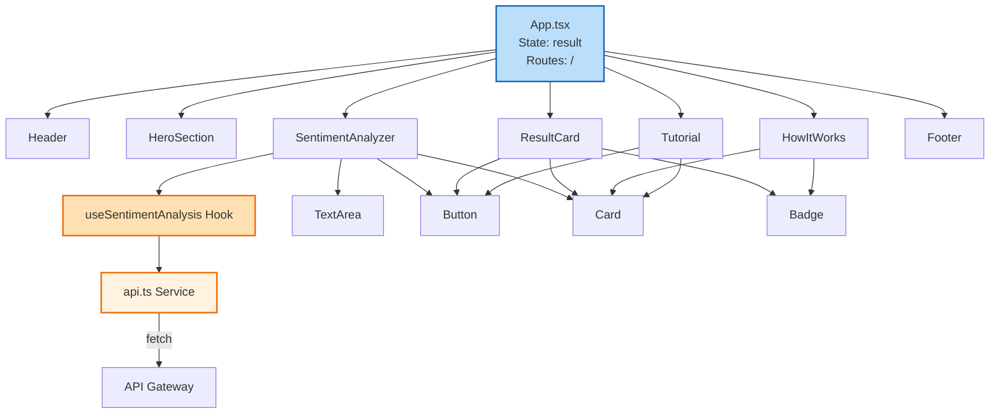
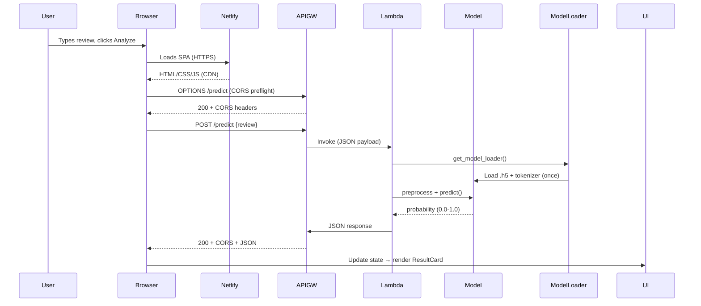
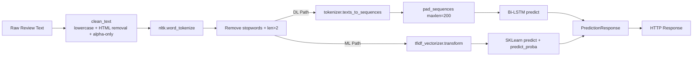
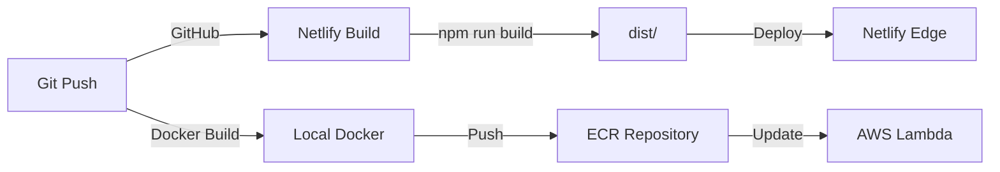

# Movie Review Sentiment Analyzer - Technical Documentation

## Project Overview

**Project Name:** Movie Review Sentiment Analyzer  
**Version:** 1.0.0  
**Architecture:** Serverless Full-Stack Application  
**Deployment:** AWS Lambda (Backend) + Netlify (Frontend)  
**Tech Stack:** FastAPI, TensorFlow, React 18, TypeScript, Vite  

---

## System Architecture Overview

```mermaid
flowchart TB
    subgraph Client["🌐 Client (Netlify CDN)"]
        UI[React 18 SPA\nNeobrutalism Design]
        Hook[useSentimentAnalysis Hook]
        API[API Service Layer]
    end

    subgraph Network["🔗 HTTPS/JSON"]
        direction LR
        CORS[CORS Preflight\nOPTIONS /predict]
        REQ[POST /predict\n(review: string)]
        RES[200 OK\n(sentiment, confidence, model_type)]
    end

    subgraph Backend["☁️ AWS Lambda (Container)"]
        GW[API Gateway HTTP API\nap-southeast-1]
        FastAPI[FastAPI + Mangum Handler]
        ModelLoader[ModelLoader Singleton]
        
        subgraph Models["🤖 ML Models"]
            DL[Bidirectional LSTM\ndeep_sentiment_model.h5\ntokenizer.pkl]
            ML[Traditional ML\nsentiment_model.pkl\ntfidf_vectorizer.pkl]
        end
        
        NLTK[NLTK Resources\n/opt/nltk_data]
    end

    UI --> Hook
    Hook --> API
    API -->|CORS| GW
    GW --> FastAPI
    FastAPI --> ModelLoader
    ModelLoader -->|Auto-detect| DL
    ModelLoader -.->|Fallback| ML
    FastAPI --> NLTK
    FastAPI -->|JSON Response| GW
    GW -->|CORS Headers| API
    API --> Hook
    Hook --> UI

    style Client fill:#e8f5e9,stroke:#2e7d32,stroke-width:2px
    style Network fill:#fff3e0,stroke:#ef6c00,stroke-width:2px
    style Backend fill:#e3f2fd,stroke:#1565c0,stroke-width:2px
    style Models fill:#fce4ec,stroke:#c2185b,stroke-width:2px
```

---

## 1. Backend Architecture (AWS Lambda + FastAPI)

### 1.1 Directory Structure

```
backend-sentiment/
├── main.py                 # FastAPI application entry point
├── requirements.txt        # Python dependencies
├── Dockerfile              # Lambda container image definition
├── .dockerignore           # Docker build exclusions
├── model/                  # ML model artifacts (copied at build time)
│   ├── deep_sentiment_model.h5    # Keras Bi-LSTM model (~17MB)
│   ├── tokenizer.pkl              # Keras Tokenizer (~8.6MB)
│   └── tfidf_vectorizer.pkl       # Scikit-learn TF-IDF vectorizer (~179KB)
└── utils/
    ├── __init__.py
    ├── nltk_setup.py         # NLTK resource management for Lambda
    ├── preprocessing.py      # Text preprocessing pipelines
    └── model_loader.py       # Model loading with auto-detection
```

### 1.2 Core Components

#### `main.py` - FastAPI Application
- **Framework:** FastAPI 0.109.0 with Mangum 0.17.0 for Lambda compatibility
- **ASGI Handler:** `handler = Mangum(app)` at module level for Lambda integration
- **Lifespan Management:** Async context manager for startup/shutdown
- **CORS Configuration:** Permissive (`allow_origins=["*"]`) for Netlify integration
- **Endpoints:**
  - `GET /health` - Health check with model status
  - `POST /predict` - Sentiment analysis endpoint

#### `model_loader.py` - Model Management
```python
class ModelLoader:
    - Auto-detection: Prioritizes deep_sentiment_model.h5, falls back to sentiment_model.pkl
    - Lazy singleton pattern via get_model_loader()
    - Properties: use_deep_model, model, tokenizer, tfidf_vectorizer, max_len
    - Methods: load_models(), is_ready(), get_model_type()
```

#### `preprocessing.py` - Text Processing Pipelines
| Function | Purpose | Stemming |
|----------|---------|----------|
| `preprocess_text_dl()` | Deep Learning pipeline | No (preserves morphology) |
| `preprocess_text_ml()` | Traditional ML pipeline | Yes (PorterStemmer) |
| `clean_text()` | Lowercase, HTML removal, non-alpha filtering | - |
| `tokenize_and_filter()` | NLTK tokenization + stopword removal | Configurable |

#### `nltk_setup.py` - Lambda-Compatible NLTK
- Downloads to `/opt/nltk_data` (persistent in container)
- Resources: `stopwords`, `punkt`
- Checks existing paths before downloading

### 1.3 Data Models (Pydantic)

```python
# Request
class ReviewInput(BaseModel):
    review: str  # Validated: non-empty, stripped

# Response
class PredictionResponse(BaseModel):
    sentiment: str        # "Positive" | "Negative"
    confidence: float     # 0.0 - 1.0
    model_type: str       # "deep_learning" | "traditional_ml"

# Health
{
    "status": "healthy",
    "model_loaded": true,
    "model_type": "deep_learning"
}
```

### 1.4 ML Model Details

#### Deep Learning Model (Primary)
- **Architecture:** Bidirectional LSTM
- **Layers:** Embedding(10000, 128) → BiLSTM(64, return_sequences=True) → BiLSTM(32) → Dense(64, ReLU) → Dropout(0.5) → Dense(1, Sigmoid)
- **Parameters:** ~1.4M trainable
- **Input:** Sequences padded to max_len=200
- **Vocabulary:** Top 10,000 words
- **Training:** IMDB 50K reviews, 80/20 split, Adam optimizer, Binary Crossentropy

#### Traditional ML Model (Fallback)
- **Algorithm:** Scikit-learn classifier (Logistic Regression / SVM)
- **Features:** TF-IDF vectorization
- **Preprocessing:** Includes PorterStemmer

### 1.5 Docker Configuration
- **Base Image:** `public.ecr.aws/lambda/python:3.10` (Amazon Linux 2)
- **System Dependencies:** gcc, gcc-c++, make, libgomp, pkg-config, hdf5-devel, cmake
- **Python Dependencies:** Installed with `--only-binary=:all:` for Lambda compatibility
- **NLTK Data:** Pre-downloaded at build time to `/opt/nltk_data`
- **Model Files:** Copied into container at `/var/task/model/`
- **Memory:** 3008 MB, Timeout: 60s (configured in Lambda)

---

## 2. Frontend Architecture (React + Vite + Netlify)

### 2.1 Directory Structure

```
frontend/
├── public/
│   ├── favicon.svg
│   └── icons.svg
├── src/
│   ├── components/
│   │   ├── ui/                    # Reusable design system
│   │   │   ├── Button.tsx         # Neobrutalism button variants
│   │   │   ├── TextArea.tsx       # Form textarea with char count
│   │   │   ├── Card.tsx           # Container with shadow/border
│   │   │   ├── Badge.tsx          # Status badges (pos/neg/info)
│   │   │   └── index.ts
│   │   ├── Header.tsx             # Navigation + logo
│   │   ├── HeroSection.tsx        # Landing section with stats
│   │   ├── SentimentAnalyzer.tsx  # Main form component
│   │   ├── ResultCard.tsx         # Prediction display
│   │   ├── HowItWorks.tsx         # 3-step process explanation
│   │   ├── Tutorial.tsx           # Accordion-style guide
│   │   ├── Footer.tsx             # Links + version info
│   │   └── index.ts
│   ├── hooks/
│   │   └── useSentimentAnalysis.ts  # State + API integration
│   ├── services/
│   │   └── api.ts               # Fetch wrapper + error handling
│   ├── types/
│   │   └── index.ts             # TypeScript interfaces
│   ├── App.tsx                  # Root component + routing
│   ├── main.tsx                 # Entry point
│   ├── index.css                # Neobrutalism design system
│   └── vite-env.d.ts
├── index.html                   # HTML template + meta tags
├── package.json
├── tsconfig.json
├── vite.config.ts
├── netlify.toml                 # Netlify deployment config
├── .env.local                   # VITE_API_URL
└── README.md
```

### 2.2 Component Architecture



### 2.3 Key Components

#### `SentimentAnalyzer.tsx`
- **Props:** `onAnalyzeComplete?: (result: SentimentResult) => void`
- **State:** Local `review` string, delegates analysis to hook
- **Flow:** Form submit → `analyze()` → hook returns result → `onAnalyzeComplete` callback

#### `ResultCard.tsx`
- **Props:** `result: SentimentResult`, `onAnalyzeAnother: () => void`
- **Features:** Sentiment badge (green/red), confidence %, model type, input preview
- **UX:** Auto-scrolls into view on mount

#### `useSentimentAnalysis.ts` (Hook)
```typescript
interface UseSentimentAnalysisReturn {
  analyze: (review: string) => Promise<void>;
  result: SentimentResult | null;
  loading: boolean;
  error: string | null;
  clearResult: () => void;
  clearError: () => void;
}
```
- Manages: `loading`, `error`, `result` state
- Calls `api.analyzeSentiment()`
- Transforms API response to `SentimentResult`

#### `api.ts` (Service Layer)
- **Base URL:** `import.meta.env.VITE_API_URL` (injected at build)
- **Endpoints:** `analyzeSentiment()`, `checkHealth()`
- **Error Handling:** Custom `ApiError` class with status code
- **Response Processing:** Validates HTTP status, parses JSON

### 2.4 TypeScript Types (`types/index.ts`)

```typescript
interface PredictRequest { review: string }
interface PredictResponse { 
  sentiment: 'Positive' | 'Negative'; 
  confidence: number; 
  model_type: string; 
}
interface HealthResponse { 
  status: string; 
  model_loaded: boolean; 
  model_type: string; 
}
interface SentimentResult {  // Frontend-enriched
  sentiment: 'Positive' | 'Negative';
  confidence: number;
  modelType: string;
  inputText: string;
}
```

### 2.5 Neobrutalism Design System (`index.css`)

| Category | CSS Variables |
|----------|---------------|
| **Colors** | `--bg-primary: #fff`, `--bg-secondary: #f5f5f5`, `--text-primary: #1a1a1a`, `--accent-primary: #000`, `--accent-success: #00cc66`, `--accent-secondary: #ff3333`, `--accent-warning: #ffcc00` |
| **Borders** | `--border-width: 3px`, `--border-color: #000`, `--border-radius: 0` |
| **Shadows** | `--shadow-x: 4px`, `--shadow-y: 4px`, `--shadow-color: #000` |
| **Typography** | `--font-sans: Inter/System UI`, `--font-mono: ui-monospace` |
| **Transitions** | `--transition-fast: 150ms ease` |

**Component Patterns:**
- Buttons: 3px border, 4px offset shadow, uppercase, `active` state shifts shadow
- Cards: 3px border, 4px shadow, flat backgrounds
- Inputs: 3px border, focus shifts shadow (2px/2px)
- Badges: Color-coded (green/red/yellow/black), uppercase

### 2.6 Build & Deployment

| Config | Value |
|--------|-------|
| **Build Tool** | Vite 5 + TypeScript |
| **Output Dir** | `dist/` |
| **Node Version** | 20 |
| **Build Command** | `npm run build` |
| **Publish Dir** | `dist` |
| **SPA Redirect** | `/* → /index.html` (200) |
| **Caching** | Assets: 1yr immutable, HTML: no-cache |
| **Security Headers** | X-Frame-Options: DENY, X-Content-Type-Options: nosniff |

---

## 3. Communication Protocol

### 3.1 API Contract

#### `POST /predict`
**Request:**
```json
{
  "review": "This movie was absolutely fantastic! Great acting and plot."
}
```

**Response (200):**
```json
{
  "sentiment": "Positive",
  "confidence": 0.7135,
  "model_type": "deep_learning"
}
```

**Error Responses:**
- `400` - Validation error (empty review)
- `503` - Model not loaded
- `500` - Internal server error

#### `GET /health`
**Response (200):**
```json
{
  "status": "healthy",
  "model_loaded": true,
  "model_type": "deep_learning"
}
```

### 3.2 CORS Configuration

**API Gateway (HTTP API):**
```json
{
  "AllowOrigins": ["*"],
  "AllowMethods": ["GET", "POST", "OPTIONS"],
  "AllowHeaders": ["Content-Type"],
  "MaxAge": 86400
}
```

**FastAPI Middleware:**
```python
CORSMiddleware(
    allow_origins=["*"],
    allow_credentials=True,
    allow_methods=["*"],
    allow_headers=["*"]
)
```

**OPTIONS Preflight Routes:** Explicitly added for `/predict` and `/health`

### 3.3 Request/Response Flow



---

## 4. Data Flow Details

### 4.1 Frontend → Backend

1. **User Input:** Textarea captures review (≥10 chars, ≤5000)
2. **Validation:** Client-side (required, trim) + Server-side (Pydantic)
3. **API Call:** `fetch(API_BASE_URL + '/predict', {method: 'POST', body: JSON})`
4. **Error Handling:** Network errors, HTTP errors, validation errors

### 4.2 Backend Processing Pipeline



### 4.3 Model Selection Logic

```python
# In ModelLoader.load_models():
self.use_deep_model = deep_model_path.exists()

if self.use_deep_model:
    # Load Keras model + tokenizer
else:
    # Load pickle model + TF-IDF vectorizer
```

---

## 5. Deployment Architecture

### 5.1 AWS Resources

| Resource | Name/ID | Configuration |
|----------|---------|---------------|
| **ECR Repository** | `sentiment-analysis-lambda` | Private, scan on push |
| **Lambda Function** | `sentiment-analysis-api` | 3008 MB, 60s timeout, x86_64 |
| **API Gateway** | `sentiment-analysis-api` (HTTP API) | Auto-deploy `prod` stage |
| **IAM Role** | `sentiment-analysis-lambda-role` | `AWSLambdaBasicExecutionRole` |
| **CloudWatch Log Group** | `/aws/lambda/sentiment-analysis-api` | Retention: default |

### 5.2 Netlify Resources

| Resource | Configuration |
|----------|---------------|
| **Site** | `sentiment-movie-review-analysis` |
| **Build** | `npm run build` → `dist/` |
| **Env Var** | `VITE_API_URL=https://2jgdfrrhxf.execute-api.ap-southeast-1.amazonaws.com` |
| **Redirects** | SPA fallback: `/* → /index.html` |
| **Headers** | Security headers + asset caching |

### 5.3 CI/CD Flow



---

## 6. Security Considerations

| Layer | Measures |
|-------|----------|
| **Transport** | HTTPS everywhere (Netlify + API Gateway) |
| **CORS** | Explicit origins in production, `*` for development |
| **Input Validation** | Pydantic (backend), React controlled components (frontend) |
| **Error Handling** | No stack traces in production responses |
| **Headers** | X-Frame-Options: DENY, X-Content-Type-Options: nosniff |
| **Lambda** | Least privilege IAM, no VPC (public API), ephemeral storage 512MB |
| **Model Files** | Bundled in container image (not downloaded at runtime) |

---

## 7. Performance Characteristics

### 7.1 Latency Breakdown

| Phase | Typical Duration |
|-------|------------------|
| **Cold Start (Lambda)** | 15-25s (model loading) |
| **Warm Invoke** | 100-300ms |
| **Model Inference (DL)** | 50-150ms |
| **Model Inference (ML)** | 10-50ms |
| **API Gateway** | 10-30ms |
| **Network (Client→APIGW)** | 50-200ms (geo-dependent) |
| **Netlify CDN** | <50ms (edge cached) |

### 7.2 Optimization Strategies

- **Pre-downloaded NLTK data** in Docker image
- **Model loaded once** per container lifecycle (singleton)
- **Binary-only pip install** for faster builds
- **Netlify CDN** for static assets
- **Preconnect hints** in HTML for API domain

---

## 8. Monitoring & Observability

### 8.1 Available Metrics

| Source | Metrics |
|--------|---------|
| **CloudWatch (Lambda)** | Invocations, Duration, Errors, Throttles, Memory |
| **CloudWatch (API Gateway)** | Count, Latency, 4XX/5XX, Integration Latency |
| **Netlify Analytics** | Page views, Bandwidth, Build status |

### 8.2 Logging

```python
# Lambda structured logs (JSON)
{
  "timestamp": "2026-10-19T06:00:00Z",
  "level": "INFO",
  "message": "Model loaded successfully",
  "model_type": "deep_learning",
  "cold_start": true
}
```

---

## 9. Known Limitations & Future Improvements

### 9.1 Current Limitations

1. **Cold Start Latency:** 15-25s on first request after idle
2. **No Authentication:** Public API, no rate limiting
3. **Binary Classification Only:** Positive/Negative (no neutral)
4. **English Only:** Trained on IMDB dataset
5. **No Neutral Class:** Confidence near 50% for ambiguous reviews

### 9.2 Recommended Enhancements

| Priority | Improvement |
|----------|-------------|
| **High** | Provisioned Concurrency (eliminate cold starts) |
| **High** | API Keys + Usage Plans (rate limiting) |
| **Medium** | Custom Domain + SSL (Netlify + API Gateway) |
| **Medium** | Structured Logging + X-Ray Tracing |
| **Low** | Model Versioning (A/B testing) |
| **Low** | Feedback Loop (user correction → retraining) |

---

## 10. Quick Reference

### 10.1 Key URLs

| Environment | Frontend | Backend API |
|-------------|----------|-------------|
| **Production** | https://sentiment-movie-review-analysis.netlify.app | https://2jgdfrrhxf.execute-api.ap-southeast-1.amazonaws.com |
| **Health Check** | - | `/health` |
| **Prediction** | - | `/predict` |

### 10.2 Common Commands

```bash
# Backend - Local Development
cd backend-sentiment
uvicorn main:app --reload --port 8000

# Backend - Docker Build
docker build -t sentiment-analysis-lambda:latest .
docker run -p 9000:8080 sentiment-analysis-lambda:latest

# Backend - Deploy to AWS
aws ecr get-login-password | docker login ...
docker push <account>.dkr.ecr.<region>.amazonaws.com/sentiment-analysis-lambda:latest
aws lambda update-function-code --function-name sentiment-analysis-api --image-uri ...

# Frontend - Local Development
cd frontend
npm run dev

# Frontend - Build & Deploy
npm run build
netlify deploy --prod --dir=dist
```

---

## 11. Appendix: File Manifest

### Backend Files
- `backend-sentiment/main.py` - FastAPI app (109 lines)
- `backend-sentiment/requirements.txt` - 9 dependencies
- `backend-sentiment/Dockerfile` - Lambda container (25 lines)
- `backend-sentiment/utils/model_loader.py` - Model management (61 lines)
- `backend-sentiment/utils/preprocessing.py` - Text pipelines (43 lines)
- `backend-sentiment/utils/nltk_setup.py` - NLTK for Lambda (30 lines)

### Frontend Files
- `frontend/src/App.tsx` - Root + routing (50 lines)
- `frontend/src/components/SentimentAnalyzer.tsx` - Main form (115 lines)
- `frontend/src/components/ResultCard.tsx` - Results display (180 lines)
- `frontend/src/hooks/useSentimentAnalysis.ts` - State hook (66 lines)
- `frontend/src/services/api.ts` - API client (54 lines)
- `frontend/src/types/index.ts` - TypeScript types (29 lines)
- `frontend/src/index.css` - Design system (161 lines)
- `frontend/vite.config.ts` - Build config
- `frontend/netlify.toml` - Deployment config

---

*Documentation generated for Movie Review Sentiment Analyzer v1.0.0*  
*Last Updated: 2026-10-19*
